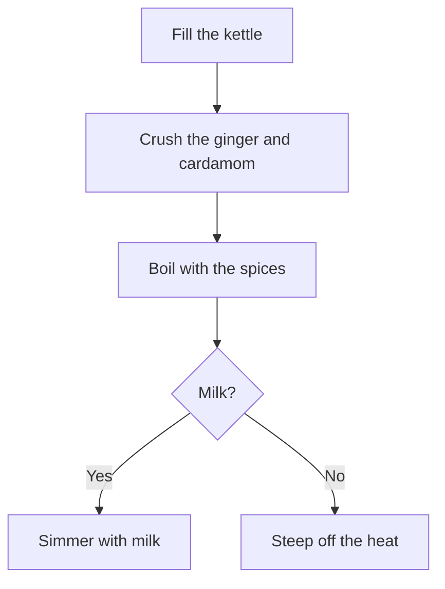
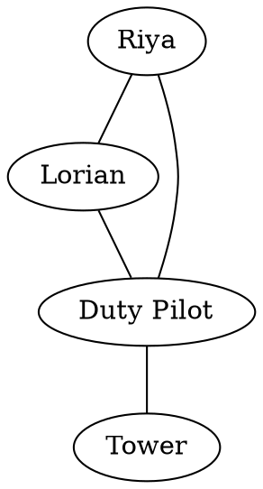

# Diagrams

> **[Open this page in Quilltap](/aurora)**

Some explanations are simply better drawn than told. A family tree of feuding cousins, the chain of command aboard an airship, the precise order in which one brews a proper cup of chai — put any of these into prose and the reader is soon counting on their fingers. Hand a character a pen, however, and they may sketch the thing right into the conversation, where it appears in the Salon as a picture rather than a paragraph.

## Granting the Pen

Drawing is an ability a character either has or hasn't, and you decide which. On the character's page in Aurora — the **Details** tab, whether you are viewing the character or editing them — you will find a card marked **Draws diagrams**:

- **Draws diagrams** — tick it, and the character is told that diagrams are within their gift and how to write one. Untick it, and they hear nothing whatsoever about the matter. The change takes effect on the character's very next turn, mid-conversation or otherwise.
- **Drawing style** — directly beneath, a choice of two hands:
  - **Hand-drawn** — sketched in ink, a touch wobbly, lettered in a hand rather than a typeface. This is the default.
  - **Clean** — ruled lines and tidy type, exactly as the drawing engine laid them out.

The style is greyed out while the pen is withheld, but it keeps its setting, so switching the ability off and on again forgets nothing. Both settings save the moment you change them; there is no need to press **Save**.

The toggle merely *permits* a character to draw. It does not make them prolific. Should you want a character who reaches for the pen at every opportunity, say so in their prompt or manifesto — something along the lines of *"You often sketch diagrams to explain things"* — and they will take the hint.

## The Three Kinds of Drawing

A character draws by writing a fenced code block in one of three diagram languages. When the message arrives, the Salon swaps the code for the picture.

### Flowcharts, Sequences, Timelines and the Like

The `mermaid` fence handles the orderly sorts of diagram: flowcharts, sequence diagrams, timelines, mind maps, state machines, Gantt charts and more.

````

````

### Webs of Connection

The `dot` fence (or `graphviz`, which means the same) is for the untidier sort of graph — who knows whom at the aerodrome, which faction owes which a favour, the rooms of a house and the doors between them.

````

````

### Freeform Drawings

The `svg` fence is for anything that isn't a diagram at all: a floor plan, a sketch of a curious object, a small teacup. The character draws it shape by shape, so it suits the simple better than the sprawling.

````
```svg
<svg viewBox="0 0 160 120" xmlns="http://www.w3.org/2000/svg">
  <ellipse cx="80" cy="92" rx="54" ry="10" fill="#e6e6e6"/>
  <rect x="40" y="52" width="70" height="30" rx="10" fill="#ffffff" stroke="#666"/>
</svg>
```
````

A freeform drawing ignores the drawing style — it is already in whatever hand the character drew it. For safety's sake, anything in it that could run a script, fetch something from elsewhere, or smuggle in a photograph is quietly removed before it reaches the page.

## Around Each Drawing

Every diagram carries a small row of buttons along its top edge:

- **View source** — shows the code beneath the drawing (and **Hide source** tucks it away again)
- **Copy source** — copies the diagram's code
- **Copy SVG** — copies the drawing itself, ready to paste into anything that understands SVG
- **Download SVG** — saves the drawing as a file

Diagrams follow your theme, light or dark, and recolour themselves when you change it. A diagram too wide for the message scrolls sideways within its frame rather than shouldering the conversation aside.

## Whose Hand?

Each diagram is drawn in the style of whoever wrote it. A character's diagrams use that character's drawing style — including your own lines, when you speak as a character you control. Diagrams you post speaking as no one in particular, and anything from the Staff, are drawn clean.

Anyone may post a diagram; the **Draws diagrams** toggle governs only whether a character is *told* about the possibility. Paste a `mermaid` block into the Salon yourself and it will render as readily as anyone's.

## While a Reply Is Arriving

A diagram is not drawn until it is finished. While a reply is still streaming in, its diagram shows as plain code; the moment the message is complete, the code gives way to the picture.

## When the Pen Blots

Should a diagram contain an error its engine cannot forgive — a bracket left open, an arrow to nowhere — you will see a short note, *"The draughtsman's pen has blotted — the diagram below could not be drawn,"* followed by the diagram's code exactly as written. Open **What the … engine said** beneath the note for the engine's own complaint. Nothing else in the message is affected.

## Diagrams and Quick-Hide

The **Salon Images** quick-hide filter leaves diagrams alone. It is meant to withhold photographs and generated pictures, and a diagram is neither — it is drawn on the page itself.

## Where Diagrams Render

For now, diagrams render in **the Salon** only. Elsewhere — help pages, file previews, the Scriptorium — a diagram fence appears as an ordinary code block. Diagrams are stored as part of the message's text, so they travel with your chats through exports, backups and search like any other words.

## In-Chat Navigation

Characters with help tools enabled can navigate directly to this page:

`help_navigate(url: "/aurora/:id/edit")`

## Related Pages

- [Editing Characters](character-editing.md) — The Details tab, where the pen is granted
- [Mathematical Notation](math-notation.md) — The Salon's other typesetting trick
- [Quick-Hide](quick-hide.md) — Filters for what the Salon shows
- [Chats Overview](chats.md) — The Salon and its workings
